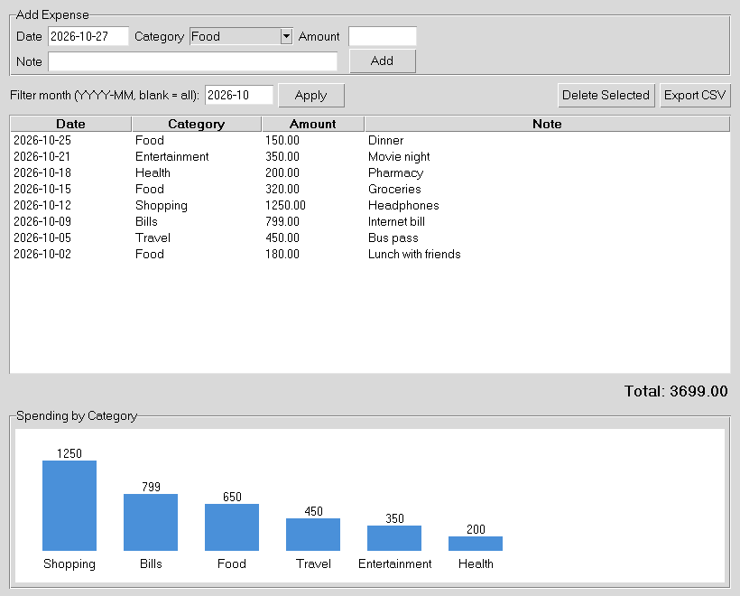

# Personal Expense Tracker

A simple desktop app to record daily expenses, filter them by month and see where the money goes.
Built with **Python, Tkinter and SQLite**. No external libraries are needed.



## Features
- Add expenses with date, category, amount and note
- Input validation (date format, numeric and positive amount)
- Data stored permanently in a local SQLite database
- Filter by month and see the running total
- Delete selected expenses
- Category-wise bar chart drawn with the Tkinter Canvas
- Export the current view to CSV

## Tech Stack
Python 3, Tkinter (UI), SQLite (database), CSV module (export)

## How to Run
```bash
git clone https://github.com/UdayKumar321/expense-tracker.git
cd expense-tracker
python expense_tracker.py
```
On Linux, if Tkinter is missing: `sudo apt install python3-tk`

## Project Structure
```
expense-tracker/
├── expense_tracker.py   # Database class + Tkinter UI
├── screenshots/app.png
├── README.md
└── .gitignore
```

## How It Works
- `Database` class: creates the table, adds, deletes and fetches expenses using parameterised queries.
- `validate()` function: checks the date and amount before saving.
- `ExpenseApp` class: builds the form, table and chart, and connects them to the database.

## Future Improvements
Budget limits with warnings, edit expense, monthly trend chart, multiple users.
